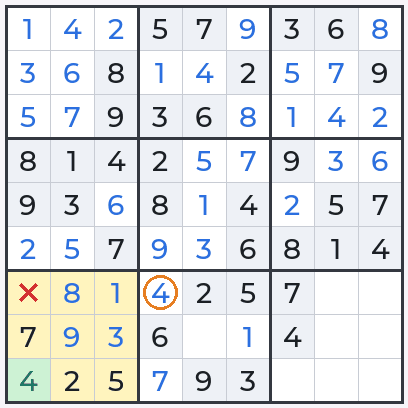

<!-- Written by tools/walkthrough.py chess-sudoku: edit the script, not this page. -->
# Chess Sudoku, step 36: the 4 in box 7

**Step 36 of 45** · [← Step 35](step-35.md) · [All steps](../chess-sudoku.md#the-whole-puzzle-step-by-step) · [Step 37 →](step-37.md)

Box 7 needs a 4. r7c1: row 7 has one (r7c4). Only **r9c1** is left: **r9c1 = 4**.

**Step 36 of 45** · [← Step 35](step-35.md) · [All steps](../chess-sudoku.md#the-whole-puzzle-step-by-step) · [Step 37 →](step-37.md)
