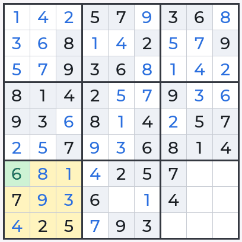

<!-- Written by tools/walkthrough.py chess-sudoku: edit the script, not this page. -->
# Chess Sudoku, step 37: the 6 in box 7

**Step 37 of 45** · [← Step 36](step-36.md) · [All steps](../chess-sudoku.md#the-whole-puzzle-step-by-step) · [Step 38 →](step-38.md)

Box 7 needs a 6, and r7c1 is its last empty cell: **r7c1 = 6**.

**Step 37 of 45** · [← Step 36](step-36.md) · [All steps](../chess-sudoku.md#the-whole-puzzle-step-by-step) · [Step 38 →](step-38.md)
