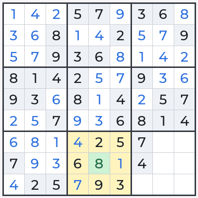

<!-- Written by tools/walkthrough.py chess-sudoku: edit the script, not this page. -->
# Chess Sudoku, step 38: the 8 in box 8

**Step 38 of 45** · [← Step 37](step-37.md) · [All steps](../chess-sudoku.md#the-whole-puzzle-step-by-step) · [Step 39 →](step-39.md)

Box 8 needs an 8, and r8c5 is its last empty cell: **r8c5 = 8**.

**Step 38 of 45** · [← Step 37](step-37.md) · [All steps](../chess-sudoku.md#the-whole-puzzle-step-by-step) · [Step 39 →](step-39.md)
