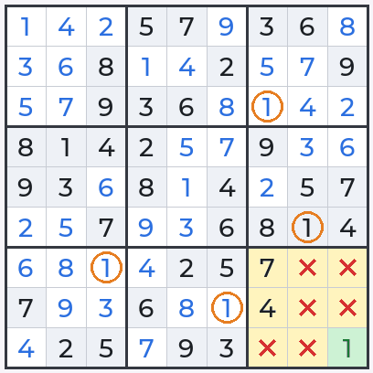

<!-- Written by tools/walkthrough.py chess-sudoku: edit the script, not this page. -->
# Chess Sudoku, step 39: the 1 in box 9

**Step 39 of 45** · [← Step 38](step-38.md) · [All steps](../chess-sudoku.md#the-whole-puzzle-step-by-step) · [Step 40 →](step-40.md)

Box 9 needs a 1. r7c8 and r7c9: row 7 has one (r7c3). r8c8 and r8c9: row 8 has one (r8c6). r9c7: column 7 has one (r3c7). r9c8: column 8 has one (r6c8). Only **r9c9** is left: **r9c9 = 1**.

**Step 39 of 45** · [← Step 38](step-38.md) · [All steps](../chess-sudoku.md#the-whole-puzzle-step-by-step) · [Step 40 →](step-40.md)
