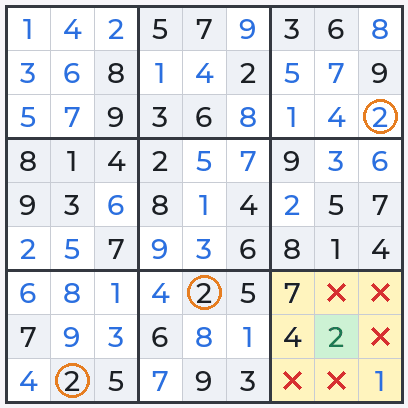

<!-- Written by tools/walkthrough.py chess-sudoku: edit the script, not this page. -->
# Chess Sudoku, step 40: the 2 in box 9

**Step 40 of 45** · [← Step 39](step-39.md) · [All steps](../chess-sudoku.md#the-whole-puzzle-step-by-step) · [Step 41 →](step-41.md)

Box 9 needs a 2. r7c8 and r7c9: row 7 has one (r7c5). r8c9: column 9 has one (r3c9). r9c7 and r9c8: row 9 has one (r9c2). Only **r8c8** is left: **r8c8 = 2**.

**Step 40 of 45** · [← Step 39](step-39.md) · [All steps](../chess-sudoku.md#the-whole-puzzle-step-by-step) · [Step 41 →](step-41.md)
