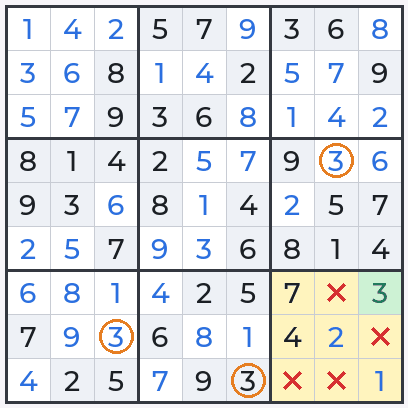

<!-- Written by tools/walkthrough.py chess-sudoku: edit the script, not this page. -->
# Chess Sudoku, step 41: the 3 in box 9

**Step 41 of 45** · [← Step 40](step-40.md) · [All steps](../chess-sudoku.md#the-whole-puzzle-step-by-step) · [Step 42 →](step-42.md)

Box 9 needs a 3. r7c8: column 8 has one (r4c8). r8c9: row 8 has one (r8c3). r9c7 and r9c8: row 9 has one (r9c6). Only **r7c9** is left: **r7c9 = 3**.

**Step 41 of 45** · [← Step 40](step-40.md) · [All steps](../chess-sudoku.md#the-whole-puzzle-step-by-step) · [Step 42 →](step-42.md)
