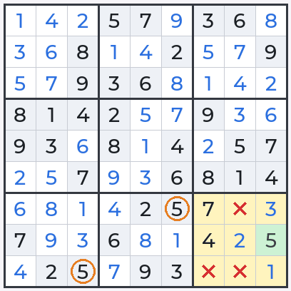

<!-- Written by tools/walkthrough.py chess-sudoku: edit the script, not this page. -->
# Chess Sudoku, step 42: the 5 in box 9

**Step 42 of 45** · [← Step 41](step-41.md) · [All steps](../chess-sudoku.md#the-whole-puzzle-step-by-step) · [Step 43 →](step-43.md)

Box 9 needs a 5. r7c8: row 7 has one (r7c6). r9c7 and r9c8: row 9 has one (r9c3). Only **r8c9** is left: **r8c9 = 5**.

**Step 42 of 45** · [← Step 41](step-41.md) · [All steps](../chess-sudoku.md#the-whole-puzzle-step-by-step) · [Step 43 →](step-43.md)
