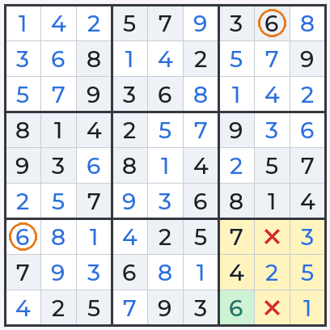

<!-- Written by tools/walkthrough.py chess-sudoku: edit the script, not this page. -->
# Chess Sudoku, step 43: the 6 in box 9

**Step 43 of 45** · [← Step 42](step-42.md) · [All steps](../chess-sudoku.md#the-whole-puzzle-step-by-step) · [Step 44 →](step-44.md)

Box 9 needs a 6. r7c8: row 7 has one (r7c1). r9c8: column 8 has one (r1c8). Only **r9c7** is left: **r9c7 = 6**.

**Step 43 of 45** · [← Step 42](step-42.md) · [All steps](../chess-sudoku.md#the-whole-puzzle-step-by-step) · [Step 44 →](step-44.md)
