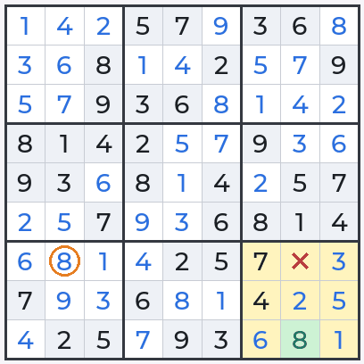

<!-- Written by tools/walkthrough.py chess-sudoku: edit the script, not this page. -->
# Chess Sudoku, step 44: the 8 in box 9

**Step 44 of 45** · [← Step 43](step-43.md) · [All steps](../chess-sudoku.md#the-whole-puzzle-step-by-step) · [Step 45 →](step-45.md)

Box 9 needs an 8. r7c8: row 7 has one (r7c2). Only **r9c8** is left: **r9c8 = 8**.

**Step 44 of 45** · [← Step 43](step-43.md) · [All steps](../chess-sudoku.md#the-whole-puzzle-step-by-step) · [Step 45 →](step-45.md)
