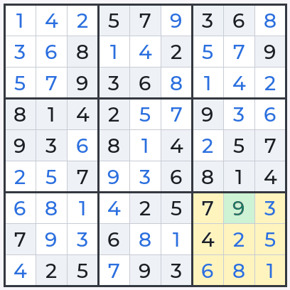

<!-- Written by tools/walkthrough.py chess-sudoku: edit the script, not this page. -->
# Chess Sudoku, step 45: the 9 in box 9

**Step 45 of 45** · [← Step 44](step-44.md) · [All steps](../chess-sudoku.md#the-whole-puzzle-step-by-step) · [All steps](../chess-sudoku.md#the-whole-puzzle-step-by-step)

Box 9 needs a 9, and r7c8 is its last empty cell: **r7c8 = 9**.

Solved.

**Step 45 of 45** · [← Step 44](step-44.md) · [All steps](../chess-sudoku.md#the-whole-puzzle-step-by-step) · [All steps](../chess-sudoku.md#the-whole-puzzle-step-by-step)
