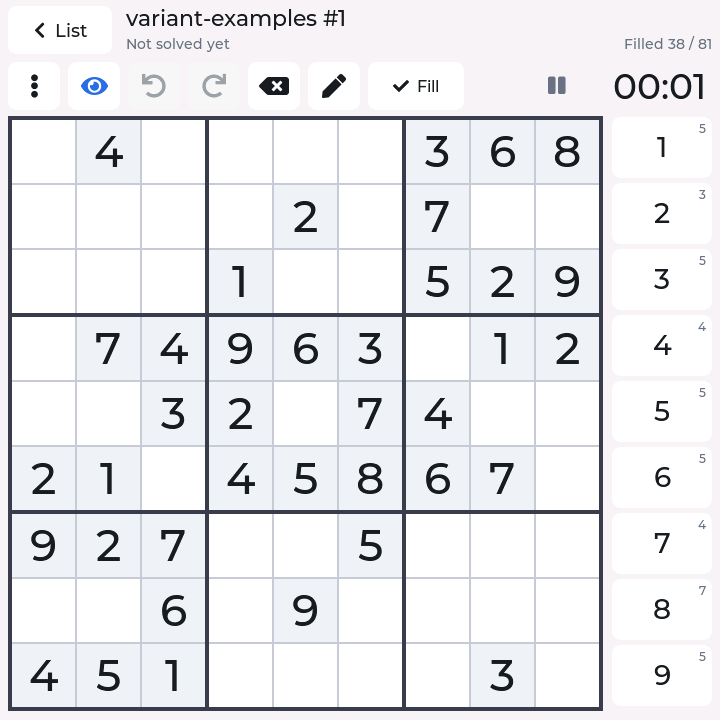
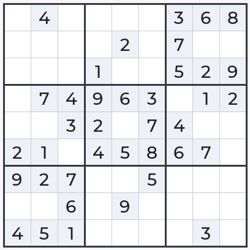

# Classic

[← All variants](README.md) · [Puzzles](../features-puzzles.md) · [How to play](../how-to-play.md)

## The rules

Fill the 9×9 grid so that every **row**, every **column** and every **3×3 box** (the nine blocks inside the thick lines) holds the digits 1 to 9, each exactly once. The grey cells are the givens: they're part of the puzzle and can't be changed. Every puzzle on the board has exactly one solution, and it can always be reached by reasoning, no guessing.

Every other variant on these pages keeps these rules and adds one of its own.

## On the board

- Tap a cell, then a digit on the pad on the right. The small number on each pad key is how many of that digit are still to place.
- A digit that repeats in a row, column or box turns red (Settings → Game → Mistake check), and the cells it clashes with show it too.
- The 1600 built-in puzzles (Puzzles → Built-in) are all Classic; **Puzzles → ⋮ → New puzzle → Classic** makes a new one at any level, and the daily puzzle is Classic.
- **Hint** (the eye) shows where to look first, then the cell and why.

## How to solve it

- **Hidden single:** pick a digit and a box (or a row or column). If every cell but one is ruled out for that digit, because the digit is already in that cell's row or column, it goes in the one that's left. This is the step to look for first.
- **Naked single:** a cell whose row, column and box already hold eight different digits can only take the ninth.
- Work through the digits that already appear most often (the pad's small counts tell you): they rule out the most cells.
- Harder puzzles need more: **pairs** (two cells in a unit that can only hold the same two digits), **pointing** (a digit that, inside a box, can only be in one row, so it's not anywhere else in that row), and beyond. **Puzzles → ⋮ → Learn** practises each technique.

## Worked example: the whole puzzle

The puzzle in the screenshot is **variant-examples #1**, a Classic Easy puzzle. To play along, import [`variant-examples.sdx`](../variant-examples.sdx) (copy it to `puzzles/` on the card, then **Files → puzzles → variant-examples.sdx → Import**): it lands in **Puzzles → Imported → variant-examples**. Cells are written **r**ow**c**olumn, counted from the top left: r1c3 is row 1, column 3.

<!-- walkthrough -->
<!-- Written by tools/walkthrough.py classic: edit the script, not this part. -->

The whole puzzle, from the start to the last cell: 43 steps, each one a single (one place left for a digit, or one digit left for a cell). Each step has a page of its own, with **Previous** and **Next**: pick its number below. In each picture, the unit the step looks at is tinted yellow (for a cell with one digit left: its row, column and box), the new digit is on green, the digits that rule cells out have an **orange ring**, and the empty cells they rule out a **red cross**. Givens are on grey, digits from earlier steps in blue.

| [1](classic/step-01.md) | [2](classic/step-02.md) | [3](classic/step-03.md) | [4](classic/step-04.md) | [5](classic/step-05.md) | [6](classic/step-06.md) | [7](classic/step-07.md) | [8](classic/step-08.md) | [9](classic/step-09.md) | [10](classic/step-10.md) |
|:-:|:-:|:-:|:-:|:-:|:-:|:-:|:-:|:-:|:-:|
| [11](classic/step-11.md) | [12](classic/step-12.md) | [13](classic/step-13.md) | [14](classic/step-14.md) | [15](classic/step-15.md) | [16](classic/step-16.md) | [17](classic/step-17.md) | [18](classic/step-18.md) | [19](classic/step-19.md) | [20](classic/step-20.md) |
| [21](classic/step-21.md) | [22](classic/step-22.md) | [23](classic/step-23.md) | [24](classic/step-24.md) | [25](classic/step-25.md) | [26](classic/step-26.md) | [27](classic/step-27.md) | [28](classic/step-28.md) | [29](classic/step-29.md) | [30](classic/step-30.md) |
| [31](classic/step-31.md) | [32](classic/step-32.md) | [33](classic/step-33.md) | [34](classic/step-34.md) | [35](classic/step-35.md) | [36](classic/step-36.md) | [37](classic/step-37.md) | [38](classic/step-38.md) | [39](classic/step-39.md) | [40](classic/step-40.md) |
| [41](classic/step-41.md) | [42](classic/step-42.md) | [43](classic/step-43.md) |  |  |  |  |  |  |  |

Solved.

<!-- /walkthrough -->
