# Classic

[← All variants](README.md) · [Puzzles](../features-puzzles.md) · [How to play](../how-to-play.md)

## The rules

Fill the 9×9 grid so that every **row**, every **column** and every **3×3 box** (the nine blocks inside the thick lines) holds the digits 1 to 9, each exactly once. The grey cells are the givens: they're part of the puzzle and can't be changed. Every puzzle on the board has exactly one solution, and it can always be reached by reasoning, no guessing.

Every other variant on these pages keeps these rules and adds one of its own.

## On the board

- Tap a cell, then a digit on the pad on the right. The small number on each pad key is how many of that digit are still to place.
- A digit that repeats in a row, column or box turns red (Settings → Game → Mistake check), and the cells it clashes with show it too.
- The 1600 built-in puzzles (Puzzles → Built-in) are all Classic; **Puzzles → ⋮ → New puzzle → Classic** makes a new one at any level, and the daily puzzle is Classic.
- **Hint** (the eye) shows where to look first, then the cell and why.

## How to solve it

- **Hidden single:** pick a digit and a box (or a row or column). If every cell but one is ruled out for that digit, because the digit is already in that cell's row or column, it goes in the one that's left. This is the step to look for first.
- **Naked single:** a cell whose row, column and box already hold eight different digits can only take the ninth.
- Work through the digits that already appear most often (the pad's small counts tell you): they rule out the most cells.
- Harder puzzles need more: **pairs** (two cells in a unit that can only hold the same two digits), **pointing** (a digit that, inside a box, can only be in one row, so it's not anywhere else in that row), and beyond. **Puzzles → ⋮ → Learn** practises each technique.

## Worked example: the whole puzzle

The puzzle in the screenshot is **variant-examples #1**, a Classic Easy puzzle. To play along, import [`variant-examples.sdx`](../variant-examples.sdx) (copy it to `puzzles/` on the card, then **Files → puzzles → variant-examples.sdx → Import**): it lands in **Puzzles → Imported → variant-examples**. Cells are written **r**ow**c**olumn, counted from the top left: r1c3 is row 1, column 3.

<!-- walkthrough -->
<!-- Written by tools/walkthrough.py classic: edit the script, not this part. -->

The whole puzzle, from the start to the last cell: 43 steps, each one a single (one place left for a digit, or one digit left for a cell). In each picture, the unit the step looks at is tinted yellow (for a cell with one digit left: its row, column and box), the new digit is on green, the digits that rule cells out have an **orange ring**, and the empty cells they rule out a **red cross**. Givens are on grey, digits from earlier steps in blue.

#### Step 1: the 2 in box 1

Box 1 needs a 2. r1c1: column 1 has one (r6c1). r2c1, r2c2 and r2c3: row 2 has one (r2c5). r3c1, r3c2 and r3c3: row 3 has one (r3c8). Only **r1c3** is left: **r1c3 = 2**.

#### Step 2: the 1 in box 3

Box 3 needs a 1. r2c8: column 8 has one (r4c8). Only **r2c9** is left: **r2c9 = 1**.

#### Step 3: the 1 in box 1

Box 1 needs a 1. r2c1, r2c2 and r2c3: row 2 has one (r2c9). r3c1, r3c2 and r3c3: row 3 has one (r3c4). Only **r1c1** is left: **r1c1 = 1**.

#### Step 4: the 7 in box 1

Box 1 needs a 7. r2c1, r2c2 and r2c3: row 2 has one (r2c7). r3c2: column 2 has one (r4c2). r3c3: column 3 has one (r7c3). Only **r3c1** is left: **r3c1 = 7**.

#### Step 5: the 4 in box 3

Box 3 needs a 4, and r2c8 is its last empty cell: **r2c8 = 4**.

#### Step 6: the 1 in box 5

Box 5 needs a 1, and r5c5 is its last empty cell: **r5c5 = 1**.

#### Step 7: the 3 in box 6

Box 6 needs a 3. r4c7: row 4 has one (r4c6). r5c8 and r5c9: row 5 has one (r5c3). Only **r6c9** is left: **r6c9 = 3**.

#### Step 8: the 9 in box 6

Box 6 needs a 9. r4c7: row 4 has one (r4c4). r5c9: column 9 has one (r3c9). Only **r5c8** is left: **r5c8 = 9**.

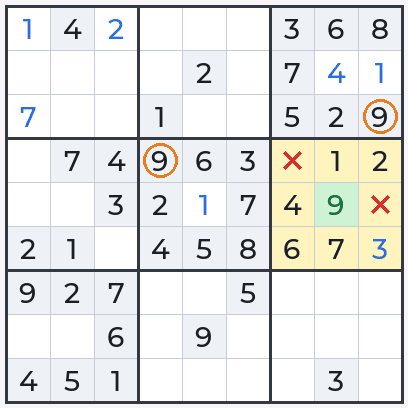

#### Step 9: the 9 in box 4

Box 4 needs a 9. r4c1: row 4 has one (r4c4). r5c1 and r5c2: row 5 has one (r5c8). Only **r6c3** is left: **r6c3 = 9**.

#### Step 10: the 9 in box 1

Box 1 needs a 9. r2c1: column 1 has one (r7c1). r2c3: column 3 has one (r6c3). r3c2 and r3c3: row 3 has one (r3c9). Only **r2c2** is left: **r2c2 = 9**.

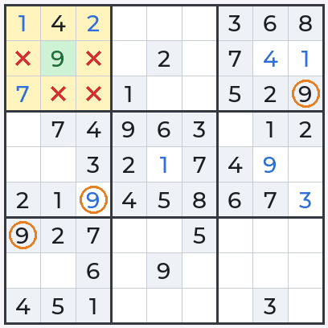

#### Step 11: the 9 in box 2

Box 2 needs a 9. r1c4: column 4 has one (r4c4). r1c5: column 5 has one (r8c5). r2c4 and r2c6: row 2 has one (r2c2). r3c5 and r3c6: row 3 has one (r3c9). Only **r1c6** is left: **r1c6 = 9**.

#### Step 12: the 5 in box 6

Box 6 needs a 5. r4c7: column 7 has one (r3c7). Only **r5c9** is left: **r5c9 = 5**.

#### Step 13: the 5 in box 4

Box 4 needs a 5. r5c1 and r5c2: row 5 has one (r5c9). Only **r4c1** is left: **r4c1 = 5**.

#### Step 14: the 5 in box 1

Box 1 needs a 5. r2c1: column 1 has one (r4c1). r3c2 and r3c3: row 3 has one (r3c7). Only **r2c3** is left: **r2c3 = 5**.

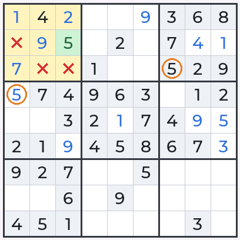

#### Step 15: the 5 in box 2

Box 2 needs a 5. r1c5: column 5 has one (r6c5). r2c4 and r2c6: row 2 has one (r2c3). r3c5 and r3c6: row 3 has one (r3c7). Only **r1c4** is left: **r1c4 = 5**.

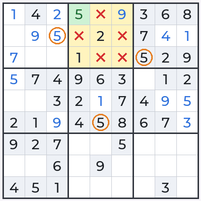

#### Step 16: the 7 in box 2

Box 2 needs a 7. r2c4 and r2c6: row 2 has one (r2c7). r3c5 and r3c6: row 3 has one (r3c1). Only **r1c5** is left: **r1c5 = 7**.

#### Step 17: the 8 in box 6

Box 6 needs an 8, and r4c7 is its last empty cell: **r4c7 = 8**.

#### Step 18: the 1 in box 8

Box 8 needs a 1. r7c4 and r8c4: column 4 has one (r3c4). r7c5: column 5 has one (r5c5). r9c4, r9c5 and r9c6: row 9 has one (r9c3). Only **r8c6** is left: **r8c6 = 1**.

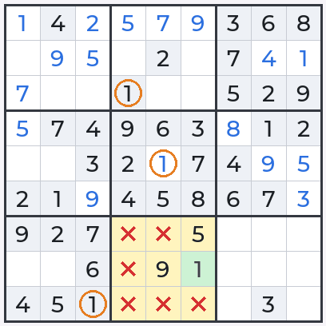

#### Step 19: the 2 in box 8

Box 8 needs a 2. r7c4 and r7c5: row 7 has one (r7c2). r8c4 and r9c4: column 4 has one (r5c4). r9c5: column 5 has one (r2c5). Only **r9c6** is left: **r9c6 = 2**.

#### Step 20: the 4 in box 8

Box 8 needs a 4. r7c4 and r8c4: column 4 has one (r6c4). r9c4 and r9c5: row 9 has one (r9c1). Only **r7c5** is left: **r7c5 = 4**.

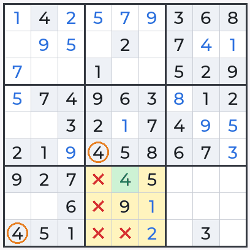

#### Step 21: the 4 in box 2

Box 2 needs a 4. r2c4 and r2c6: row 2 has one (r2c8). r3c5: column 5 has one (r7c5). Only **r3c6** is left: **r3c6 = 4**.

#### Step 22: the 1 in box 9

Box 9 needs a 1. r7c8: column 8 has one (r4c8). r7c9: column 9 has one (r2c9). r8c7, r8c8 and r8c9: row 8 has one (r8c6). r9c7 and r9c9: row 9 has one (r9c3). Only **r7c7** is left: **r7c7 = 1**.

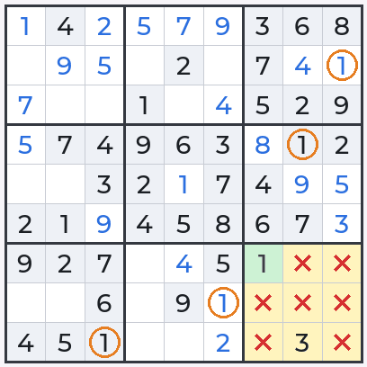

#### Step 23: the 2 in box 9

Box 9 needs a 2. r7c8 and r7c9: row 7 has one (r7c2). r8c8: column 8 has one (r3c8). r8c9: column 9 has one (r4c9). r9c7 and r9c9: row 9 has one (r9c6). Only **r8c7** is left: **r8c7 = 2**.

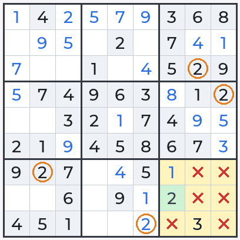

#### Step 24: the 4 in box 9

Box 9 needs a 4. r7c8 and r7c9: row 7 has one (r7c5). r8c8: column 8 has one (r2c8). r9c7 and r9c9: row 9 has one (r9c1). Only **r8c9** is left: **r8c9 = 4**.

#### Step 25: the 5 in box 9

Box 9 needs a 5. r7c8 and r7c9: row 7 has one (r7c6). r9c7 and r9c9: row 9 has one (r9c2). Only **r8c8** is left: **r8c8 = 5**.

#### Step 26: the 7 in box 9

Box 9 needs a 7. r7c8 and r7c9: row 7 has one (r7c3). r9c7: column 7 has one (r2c7). Only **r9c9** is left: **r9c9 = 7**.

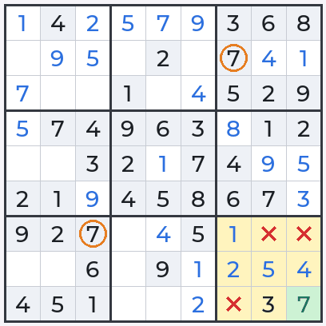

#### Step 27: the 7 in box 8

Box 8 needs a 7. r7c4: row 7 has one (r7c3). r9c4 and r9c5: row 9 has one (r9c9). Only **r8c4** is left: **r8c4 = 7**.

#### Step 28: the 3 in box 8

Box 8 needs a 3. r9c4 and r9c5: row 9 has one (r9c8). Only **r7c4** is left: **r7c4 = 3**.

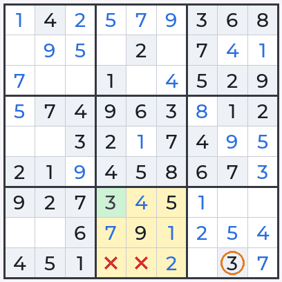

#### Step 29: the 3 in box 2

Box 2 needs a 3. r2c4: column 4 has one (r7c4). r2c6: column 6 has one (r4c6). Only **r3c5** is left: **r3c5 = 3**.

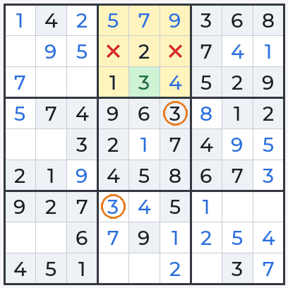

#### Step 30: the 3 in box 1

Box 1 needs a 3. r3c2 and r3c3: row 3 has one (r3c5). Only **r2c1** is left: **r2c1 = 3**.

#### Step 31: the 6 in box 1

Box 1 needs a 6. r3c3: column 3 has one (r8c3). Only **r3c2** is left: **r3c2 = 6**.

#### Step 32: the 8 in box 1

Box 1 needs an 8, and r3c3 is its last empty cell: **r3c3 = 8**.

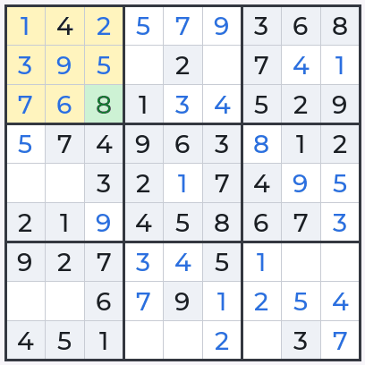

#### Step 33: the 8 in box 2

Box 2 needs an 8. r2c6: column 6 has one (r6c6). Only **r2c4** is left: **r2c4 = 8**.

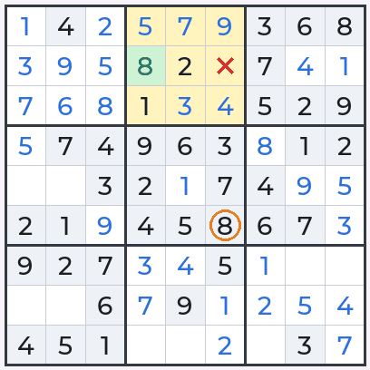

#### Step 34: the 6 in box 2

Box 2 needs a 6, and r2c6 is its last empty cell: **r2c6 = 6**.

#### Step 35: the 6 in box 4

Box 4 needs a 6. r5c2: column 2 has one (r3c2). Only **r5c1** is left: **r5c1 = 6**.

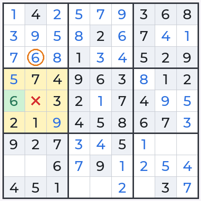

#### Step 36: the 8 in box 4

Box 4 needs an 8, and r5c2 is its last empty cell: **r5c2 = 8**.

#### Step 37: the 3 in box 7

Box 7 needs a 3. r8c1: column 1 has one (r2c1). Only **r8c2** is left: **r8c2 = 3**.

#### Step 38: the 8 in box 7

Box 7 needs an 8, and r8c1 is its last empty cell: **r8c1 = 8**.

#### Step 39: the 6 in box 8

Box 8 needs a 6. r9c5: column 5 has one (r4c5). Only **r9c4** is left: **r9c4 = 6**.

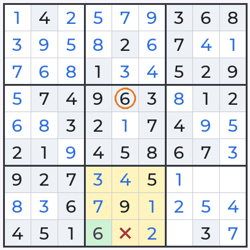

#### Step 40: the 8 in box 8

Box 8 needs an 8, and r9c5 is its last empty cell: **r9c5 = 8**.

#### Step 41: the 6 in box 9

Box 9 needs a 6. r7c8: column 8 has one (r1c8). r9c7: row 9 has one (r9c4). Only **r7c9** is left: **r7c9 = 6**.

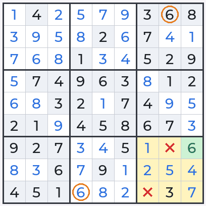

#### Step 42: the 8 in box 9

Box 9 needs an 8. r9c7: row 9 has one (r9c5). Only **r7c8** is left: **r7c8 = 8**.

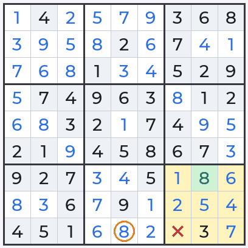

#### Step 43: the 9 in box 9

Box 9 needs a 9, and r9c7 is its last empty cell: **r9c7 = 9**.

Solved.

<!-- /walkthrough -->
