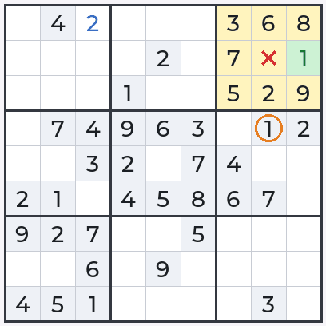

<!-- Written by tools/walkthrough.py classic: edit the script, not this page. -->
# Classic, step 2: the 1 in box 3

**Step 2 of 43** · [← Step 1](step-01.md) · [All steps](../classic.md#worked-example-the-whole-puzzle) · [Step 3 →](step-03.md)

Box 3 needs a 1. r2c8: column 8 has one (r4c8). Only **r2c9** is left: **r2c9 = 1**.

**Step 2 of 43** · [← Step 1](step-01.md) · [All steps](../classic.md#worked-example-the-whole-puzzle) · [Step 3 →](step-03.md)
