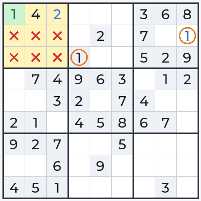

<!-- Written by tools/walkthrough.py classic: edit the script, not this page. -->
# Classic, step 3: the 1 in box 1

**Step 3 of 43** · [← Step 2](step-02.md) · [All steps](../classic.md#worked-example-the-whole-puzzle) · [Step 4 →](step-04.md)

Box 1 needs a 1. r2c1, r2c2 and r2c3: row 2 has one (r2c9). r3c1, r3c2 and r3c3: row 3 has one (r3c4). Only **r1c1** is left: **r1c1 = 1**.

**Step 3 of 43** · [← Step 2](step-02.md) · [All steps](../classic.md#worked-example-the-whole-puzzle) · [Step 4 →](step-04.md)
