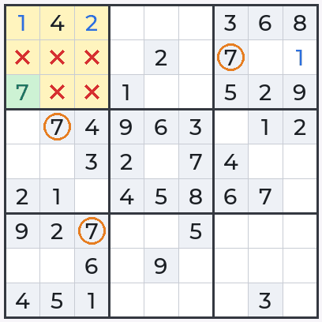

<!-- Written by tools/walkthrough.py classic: edit the script, not this page. -->
# Classic, step 4: the 7 in box 1

**Step 4 of 43** · [← Step 3](step-03.md) · [All steps](../classic.md#worked-example-the-whole-puzzle) · [Step 5 →](step-05.md)

Box 1 needs a 7. r2c1, r2c2 and r2c3: row 2 has one (r2c7). r3c2: column 2 has one (r4c2). r3c3: column 3 has one (r7c3). Only **r3c1** is left: **r3c1 = 7**.

**Step 4 of 43** · [← Step 3](step-03.md) · [All steps](../classic.md#worked-example-the-whole-puzzle) · [Step 5 →](step-05.md)
