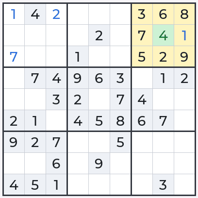

<!-- Written by tools/walkthrough.py classic: edit the script, not this page. -->
# Classic, step 5: the 4 in box 3

**Step 5 of 43** · [← Step 4](step-04.md) · [All steps](../classic.md#worked-example-the-whole-puzzle) · [Step 6 →](step-06.md)

Box 3 needs a 4, and r2c8 is its last empty cell: **r2c8 = 4**.

**Step 5 of 43** · [← Step 4](step-04.md) · [All steps](../classic.md#worked-example-the-whole-puzzle) · [Step 6 →](step-06.md)
