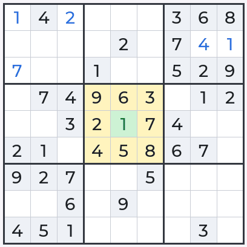

<!-- Written by tools/walkthrough.py classic: edit the script, not this page. -->
# Classic, step 6: the 1 in box 5

**Step 6 of 43** · [← Step 5](step-05.md) · [All steps](../classic.md#worked-example-the-whole-puzzle) · [Step 7 →](step-07.md)

Box 5 needs a 1, and r5c5 is its last empty cell: **r5c5 = 1**.

**Step 6 of 43** · [← Step 5](step-05.md) · [All steps](../classic.md#worked-example-the-whole-puzzle) · [Step 7 →](step-07.md)
