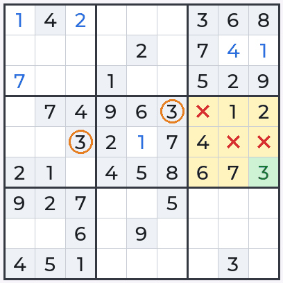

<!-- Written by tools/walkthrough.py classic: edit the script, not this page. -->
# Classic, step 7: the 3 in box 6

**Step 7 of 43** · [← Step 6](step-06.md) · [All steps](../classic.md#worked-example-the-whole-puzzle) · [Step 8 →](step-08.md)

Box 6 needs a 3. r4c7: row 4 has one (r4c6). r5c8 and r5c9: row 5 has one (r5c3). Only **r6c9** is left: **r6c9 = 3**.

**Step 7 of 43** · [← Step 6](step-06.md) · [All steps](../classic.md#worked-example-the-whole-puzzle) · [Step 8 →](step-08.md)
