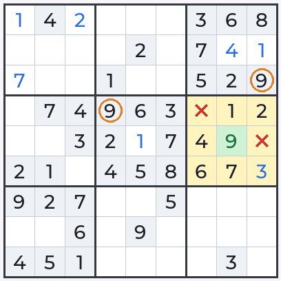

<!-- Written by tools/walkthrough.py classic: edit the script, not this page. -->
# Classic, step 8: the 9 in box 6

**Step 8 of 43** · [← Step 7](step-07.md) · [All steps](../classic.md#worked-example-the-whole-puzzle) · [Step 9 →](step-09.md)

Box 6 needs a 9. r4c7: row 4 has one (r4c4). r5c9: column 9 has one (r3c9). Only **r5c8** is left: **r5c8 = 9**.

**Step 8 of 43** · [← Step 7](step-07.md) · [All steps](../classic.md#worked-example-the-whole-puzzle) · [Step 9 →](step-09.md)
