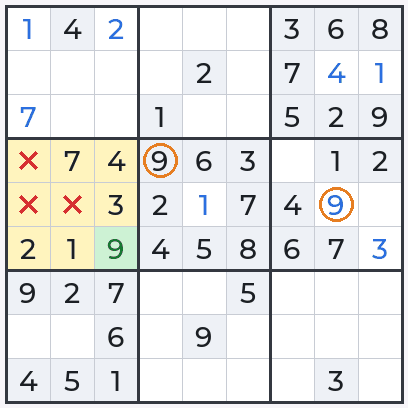

<!-- Written by tools/walkthrough.py classic: edit the script, not this page. -->
# Classic, step 9: the 9 in box 4

**Step 9 of 43** · [← Step 8](step-08.md) · [All steps](../classic.md#worked-example-the-whole-puzzle) · [Step 10 →](step-10.md)

Box 4 needs a 9. r4c1: row 4 has one (r4c4). r5c1 and r5c2: row 5 has one (r5c8). Only **r6c3** is left: **r6c3 = 9**.

**Step 9 of 43** · [← Step 8](step-08.md) · [All steps](../classic.md#worked-example-the-whole-puzzle) · [Step 10 →](step-10.md)
