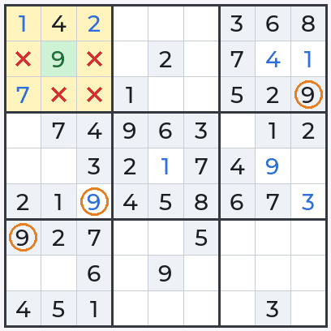

<!-- Written by tools/walkthrough.py classic: edit the script, not this page. -->
# Classic, step 10: the 9 in box 1

**Step 10 of 43** · [← Step 9](step-09.md) · [All steps](../classic.md#worked-example-the-whole-puzzle) · [Step 11 →](step-11.md)

Box 1 needs a 9. r2c1: column 1 has one (r7c1). r2c3: column 3 has one (r6c3). r3c2 and r3c3: row 3 has one (r3c9). Only **r2c2** is left: **r2c2 = 9**.

**Step 10 of 43** · [← Step 9](step-09.md) · [All steps](../classic.md#worked-example-the-whole-puzzle) · [Step 11 →](step-11.md)
