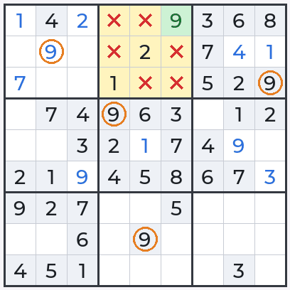

<!-- Written by tools/walkthrough.py classic: edit the script, not this page. -->
# Classic, step 11: the 9 in box 2

**Step 11 of 43** · [← Step 10](step-10.md) · [All steps](../classic.md#worked-example-the-whole-puzzle) · [Step 12 →](step-12.md)

Box 2 needs a 9. r1c4: column 4 has one (r4c4). r1c5: column 5 has one (r8c5). r2c4 and r2c6: row 2 has one (r2c2). r3c5 and r3c6: row 3 has one (r3c9). Only **r1c6** is left: **r1c6 = 9**.

**Step 11 of 43** · [← Step 10](step-10.md) · [All steps](../classic.md#worked-example-the-whole-puzzle) · [Step 12 →](step-12.md)
