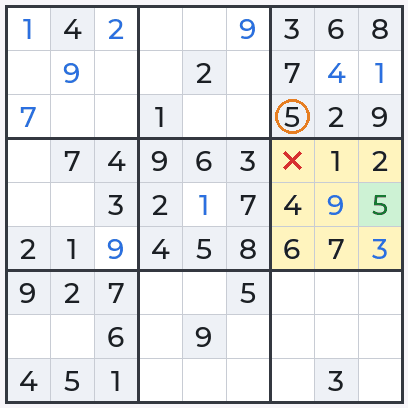

<!-- Written by tools/walkthrough.py classic: edit the script, not this page. -->
# Classic, step 12: the 5 in box 6

**Step 12 of 43** · [← Step 11](step-11.md) · [All steps](../classic.md#worked-example-the-whole-puzzle) · [Step 13 →](step-13.md)

Box 6 needs a 5. r4c7: column 7 has one (r3c7). Only **r5c9** is left: **r5c9 = 5**.

**Step 12 of 43** · [← Step 11](step-11.md) · [All steps](../classic.md#worked-example-the-whole-puzzle) · [Step 13 →](step-13.md)
