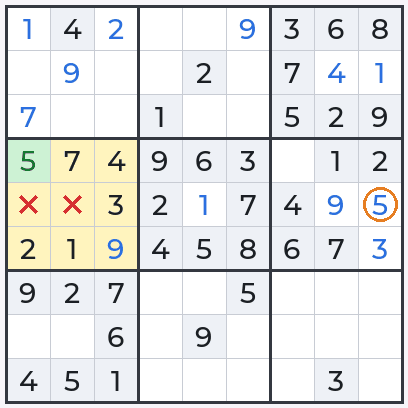

<!-- Written by tools/walkthrough.py classic: edit the script, not this page. -->
# Classic, step 13: the 5 in box 4

**Step 13 of 43** · [← Step 12](step-12.md) · [All steps](../classic.md#worked-example-the-whole-puzzle) · [Step 14 →](step-14.md)

Box 4 needs a 5. r5c1 and r5c2: row 5 has one (r5c9). Only **r4c1** is left: **r4c1 = 5**.

**Step 13 of 43** · [← Step 12](step-12.md) · [All steps](../classic.md#worked-example-the-whole-puzzle) · [Step 14 →](step-14.md)
