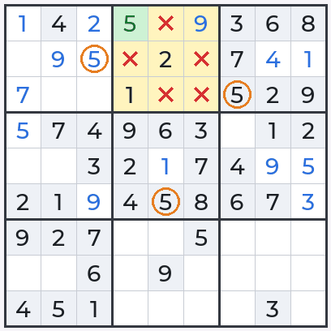

<!-- Written by tools/walkthrough.py classic: edit the script, not this page. -->
# Classic, step 15: the 5 in box 2

**Step 15 of 43** · [← Step 14](step-14.md) · [All steps](../classic.md#worked-example-the-whole-puzzle) · [Step 16 →](step-16.md)

Box 2 needs a 5. r1c5: column 5 has one (r6c5). r2c4 and r2c6: row 2 has one (r2c3). r3c5 and r3c6: row 3 has one (r3c7). Only **r1c4** is left: **r1c4 = 5**.

**Step 15 of 43** · [← Step 14](step-14.md) · [All steps](../classic.md#worked-example-the-whole-puzzle) · [Step 16 →](step-16.md)
