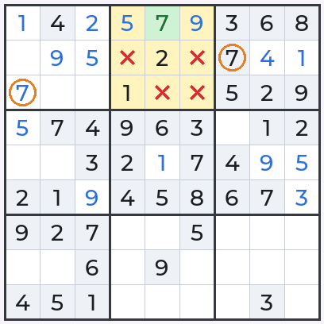

<!-- Written by tools/walkthrough.py classic: edit the script, not this page. -->
# Classic, step 16: the 7 in box 2

**Step 16 of 43** · [← Step 15](step-15.md) · [All steps](../classic.md#worked-example-the-whole-puzzle) · [Step 17 →](step-17.md)

Box 2 needs a 7. r2c4 and r2c6: row 2 has one (r2c7). r3c5 and r3c6: row 3 has one (r3c1). Only **r1c5** is left: **r1c5 = 7**.

**Step 16 of 43** · [← Step 15](step-15.md) · [All steps](../classic.md#worked-example-the-whole-puzzle) · [Step 17 →](step-17.md)
