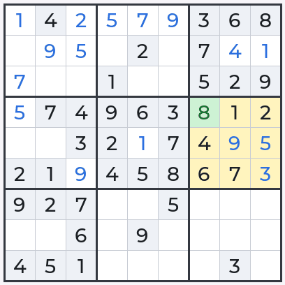

<!-- Written by tools/walkthrough.py classic: edit the script, not this page. -->
# Classic, step 17: the 8 in box 6

**Step 17 of 43** · [← Step 16](step-16.md) · [All steps](../classic.md#worked-example-the-whole-puzzle) · [Step 18 →](step-18.md)

Box 6 needs an 8, and r4c7 is its last empty cell: **r4c7 = 8**.

**Step 17 of 43** · [← Step 16](step-16.md) · [All steps](../classic.md#worked-example-the-whole-puzzle) · [Step 18 →](step-18.md)
