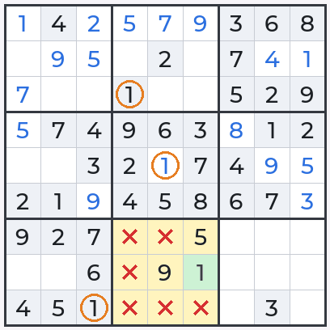

<!-- Written by tools/walkthrough.py classic: edit the script, not this page. -->
# Classic, step 18: the 1 in box 8

**Step 18 of 43** · [← Step 17](step-17.md) · [All steps](../classic.md#worked-example-the-whole-puzzle) · [Step 19 →](step-19.md)

Box 8 needs a 1. r7c4 and r8c4: column 4 has one (r3c4). r7c5: column 5 has one (r5c5). r9c4, r9c5 and r9c6: row 9 has one (r9c3). Only **r8c6** is left: **r8c6 = 1**.

**Step 18 of 43** · [← Step 17](step-17.md) · [All steps](../classic.md#worked-example-the-whole-puzzle) · [Step 19 →](step-19.md)
