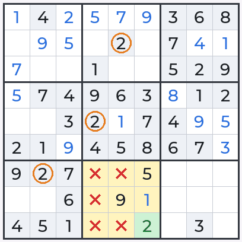

<!-- Written by tools/walkthrough.py classic: edit the script, not this page. -->
# Classic, step 19: the 2 in box 8

**Step 19 of 43** · [← Step 18](step-18.md) · [All steps](../classic.md#worked-example-the-whole-puzzle) · [Step 20 →](step-20.md)

Box 8 needs a 2. r7c4 and r7c5: row 7 has one (r7c2). r8c4 and r9c4: column 4 has one (r5c4). r9c5: column 5 has one (r2c5). Only **r9c6** is left: **r9c6 = 2**.

**Step 19 of 43** · [← Step 18](step-18.md) · [All steps](../classic.md#worked-example-the-whole-puzzle) · [Step 20 →](step-20.md)
