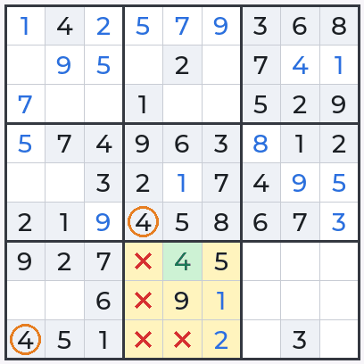

<!-- Written by tools/walkthrough.py classic: edit the script, not this page. -->
# Classic, step 20: the 4 in box 8

**Step 20 of 43** · [← Step 19](step-19.md) · [All steps](../classic.md#worked-example-the-whole-puzzle) · [Step 21 →](step-21.md)

Box 8 needs a 4. r7c4 and r8c4: column 4 has one (r6c4). r9c4 and r9c5: row 9 has one (r9c1). Only **r7c5** is left: **r7c5 = 4**.

**Step 20 of 43** · [← Step 19](step-19.md) · [All steps](../classic.md#worked-example-the-whole-puzzle) · [Step 21 →](step-21.md)
