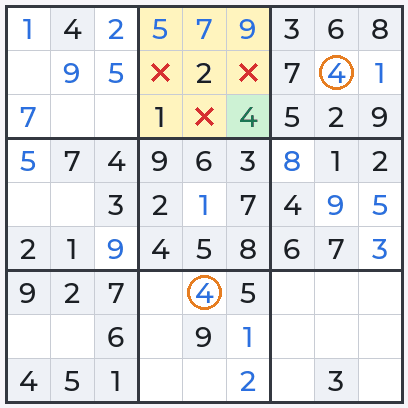

<!-- Written by tools/walkthrough.py classic: edit the script, not this page. -->
# Classic, step 21: the 4 in box 2

**Step 21 of 43** · [← Step 20](step-20.md) · [All steps](../classic.md#worked-example-the-whole-puzzle) · [Step 22 →](step-22.md)

Box 2 needs a 4. r2c4 and r2c6: row 2 has one (r2c8). r3c5: column 5 has one (r7c5). Only **r3c6** is left: **r3c6 = 4**.

**Step 21 of 43** · [← Step 20](step-20.md) · [All steps](../classic.md#worked-example-the-whole-puzzle) · [Step 22 →](step-22.md)
