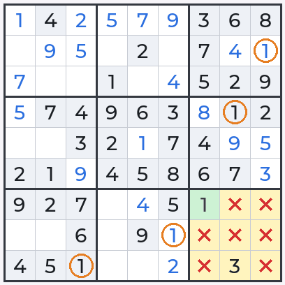

<!-- Written by tools/walkthrough.py classic: edit the script, not this page. -->
# Classic, step 22: the 1 in box 9

**Step 22 of 43** · [← Step 21](step-21.md) · [All steps](../classic.md#worked-example-the-whole-puzzle) · [Step 23 →](step-23.md)

Box 9 needs a 1. r7c8: column 8 has one (r4c8). r7c9: column 9 has one (r2c9). r8c7, r8c8 and r8c9: row 8 has one (r8c6). r9c7 and r9c9: row 9 has one (r9c3). Only **r7c7** is left: **r7c7 = 1**.

**Step 22 of 43** · [← Step 21](step-21.md) · [All steps](../classic.md#worked-example-the-whole-puzzle) · [Step 23 →](step-23.md)
