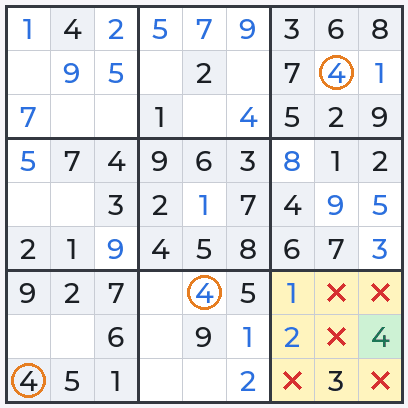

<!-- Written by tools/walkthrough.py classic: edit the script, not this page. -->
# Classic, step 24: the 4 in box 9

**Step 24 of 43** · [← Step 23](step-23.md) · [All steps](../classic.md#worked-example-the-whole-puzzle) · [Step 25 →](step-25.md)

Box 9 needs a 4. r7c8 and r7c9: row 7 has one (r7c5). r8c8: column 8 has one (r2c8). r9c7 and r9c9: row 9 has one (r9c1). Only **r8c9** is left: **r8c9 = 4**.

**Step 24 of 43** · [← Step 23](step-23.md) · [All steps](../classic.md#worked-example-the-whole-puzzle) · [Step 25 →](step-25.md)
