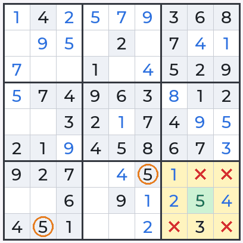

<!-- Written by tools/walkthrough.py classic: edit the script, not this page. -->
# Classic, step 25: the 5 in box 9

**Step 25 of 43** · [← Step 24](step-24.md) · [All steps](../classic.md#worked-example-the-whole-puzzle) · [Step 26 →](step-26.md)

Box 9 needs a 5. r7c8 and r7c9: row 7 has one (r7c6). r9c7 and r9c9: row 9 has one (r9c2). Only **r8c8** is left: **r8c8 = 5**.

**Step 25 of 43** · [← Step 24](step-24.md) · [All steps](../classic.md#worked-example-the-whole-puzzle) · [Step 26 →](step-26.md)
