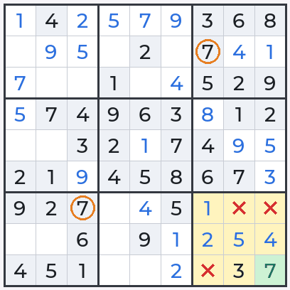

<!-- Written by tools/walkthrough.py classic: edit the script, not this page. -->
# Classic, step 26: the 7 in box 9

**Step 26 of 43** · [← Step 25](step-25.md) · [All steps](../classic.md#worked-example-the-whole-puzzle) · [Step 27 →](step-27.md)

Box 9 needs a 7. r7c8 and r7c9: row 7 has one (r7c3). r9c7: column 7 has one (r2c7). Only **r9c9** is left: **r9c9 = 7**.

**Step 26 of 43** · [← Step 25](step-25.md) · [All steps](../classic.md#worked-example-the-whole-puzzle) · [Step 27 →](step-27.md)
