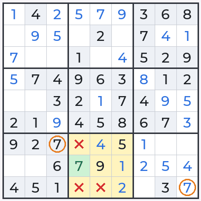

<!-- Written by tools/walkthrough.py classic: edit the script, not this page. -->
# Classic, step 27: the 7 in box 8

**Step 27 of 43** · [← Step 26](step-26.md) · [All steps](../classic.md#worked-example-the-whole-puzzle) · [Step 28 →](step-28.md)

Box 8 needs a 7. r7c4: row 7 has one (r7c3). r9c4 and r9c5: row 9 has one (r9c9). Only **r8c4** is left: **r8c4 = 7**.

**Step 27 of 43** · [← Step 26](step-26.md) · [All steps](../classic.md#worked-example-the-whole-puzzle) · [Step 28 →](step-28.md)
