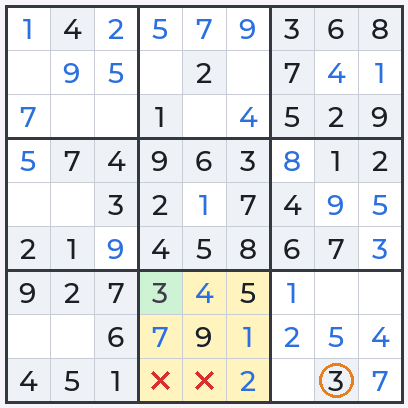

<!-- Written by tools/walkthrough.py classic: edit the script, not this page. -->
# Classic, step 28: the 3 in box 8

**Step 28 of 43** · [← Step 27](step-27.md) · [All steps](../classic.md#worked-example-the-whole-puzzle) · [Step 29 →](step-29.md)

Box 8 needs a 3. r9c4 and r9c5: row 9 has one (r9c8). Only **r7c4** is left: **r7c4 = 3**.

**Step 28 of 43** · [← Step 27](step-27.md) · [All steps](../classic.md#worked-example-the-whole-puzzle) · [Step 29 →](step-29.md)
