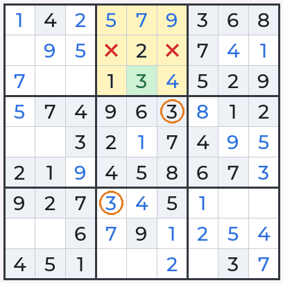

<!-- Written by tools/walkthrough.py classic: edit the script, not this page. -->
# Classic, step 29: the 3 in box 2

**Step 29 of 43** · [← Step 28](step-28.md) · [All steps](../classic.md#worked-example-the-whole-puzzle) · [Step 30 →](step-30.md)

Box 2 needs a 3. r2c4: column 4 has one (r7c4). r2c6: column 6 has one (r4c6). Only **r3c5** is left: **r3c5 = 3**.

**Step 29 of 43** · [← Step 28](step-28.md) · [All steps](../classic.md#worked-example-the-whole-puzzle) · [Step 30 →](step-30.md)
