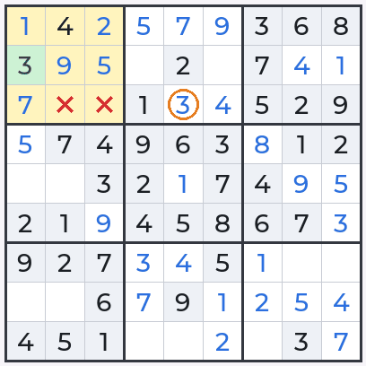

<!-- Written by tools/walkthrough.py classic: edit the script, not this page. -->
# Classic, step 30: the 3 in box 1

**Step 30 of 43** · [← Step 29](step-29.md) · [All steps](../classic.md#worked-example-the-whole-puzzle) · [Step 31 →](step-31.md)

Box 1 needs a 3. r3c2 and r3c3: row 3 has one (r3c5). Only **r2c1** is left: **r2c1 = 3**.

**Step 30 of 43** · [← Step 29](step-29.md) · [All steps](../classic.md#worked-example-the-whole-puzzle) · [Step 31 →](step-31.md)
