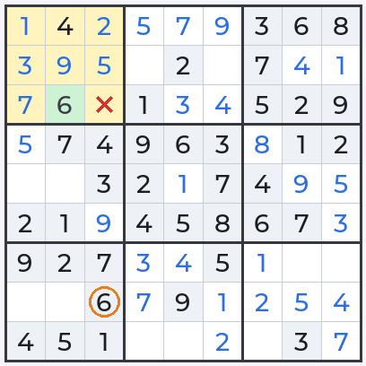

<!-- Written by tools/walkthrough.py classic: edit the script, not this page. -->
# Classic, step 31: the 6 in box 1

**Step 31 of 43** · [← Step 30](step-30.md) · [All steps](../classic.md#worked-example-the-whole-puzzle) · [Step 32 →](step-32.md)

Box 1 needs a 6. r3c3: column 3 has one (r8c3). Only **r3c2** is left: **r3c2 = 6**.

**Step 31 of 43** · [← Step 30](step-30.md) · [All steps](../classic.md#worked-example-the-whole-puzzle) · [Step 32 →](step-32.md)
