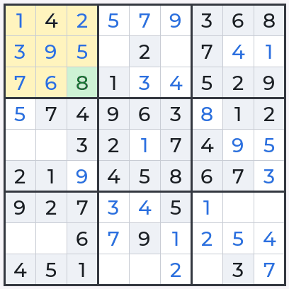

<!-- Written by tools/walkthrough.py classic: edit the script, not this page. -->
# Classic, step 32: the 8 in box 1

**Step 32 of 43** · [← Step 31](step-31.md) · [All steps](../classic.md#worked-example-the-whole-puzzle) · [Step 33 →](step-33.md)

Box 1 needs an 8, and r3c3 is its last empty cell: **r3c3 = 8**.

**Step 32 of 43** · [← Step 31](step-31.md) · [All steps](../classic.md#worked-example-the-whole-puzzle) · [Step 33 →](step-33.md)
