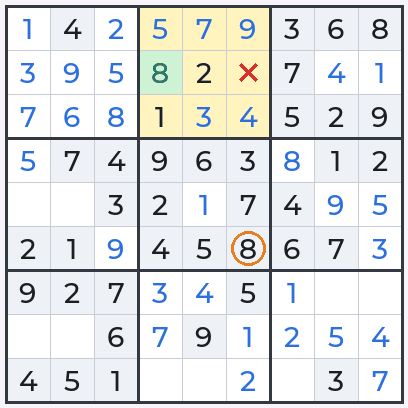

<!-- Written by tools/walkthrough.py classic: edit the script, not this page. -->
# Classic, step 33: the 8 in box 2

**Step 33 of 43** · [← Step 32](step-32.md) · [All steps](../classic.md#worked-example-the-whole-puzzle) · [Step 34 →](step-34.md)

Box 2 needs an 8. r2c6: column 6 has one (r6c6). Only **r2c4** is left: **r2c4 = 8**.

**Step 33 of 43** · [← Step 32](step-32.md) · [All steps](../classic.md#worked-example-the-whole-puzzle) · [Step 34 →](step-34.md)
