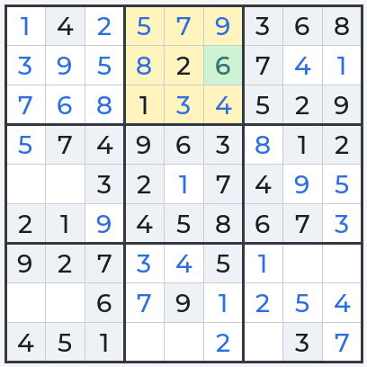

<!-- Written by tools/walkthrough.py classic: edit the script, not this page. -->
# Classic, step 34: the 6 in box 2

**Step 34 of 43** · [← Step 33](step-33.md) · [All steps](../classic.md#worked-example-the-whole-puzzle) · [Step 35 →](step-35.md)

Box 2 needs a 6, and r2c6 is its last empty cell: **r2c6 = 6**.

**Step 34 of 43** · [← Step 33](step-33.md) · [All steps](../classic.md#worked-example-the-whole-puzzle) · [Step 35 →](step-35.md)
