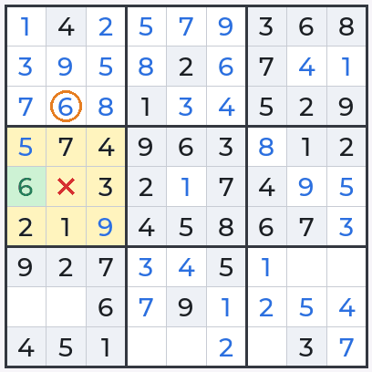

<!-- Written by tools/walkthrough.py classic: edit the script, not this page. -->
# Classic, step 35: the 6 in box 4

**Step 35 of 43** · [← Step 34](step-34.md) · [All steps](../classic.md#worked-example-the-whole-puzzle) · [Step 36 →](step-36.md)

Box 4 needs a 6. r5c2: column 2 has one (r3c2). Only **r5c1** is left: **r5c1 = 6**.

**Step 35 of 43** · [← Step 34](step-34.md) · [All steps](../classic.md#worked-example-the-whole-puzzle) · [Step 36 →](step-36.md)
