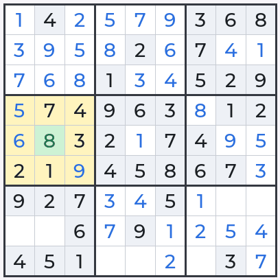

<!-- Written by tools/walkthrough.py classic: edit the script, not this page. -->
# Classic, step 36: the 8 in box 4

**Step 36 of 43** · [← Step 35](step-35.md) · [All steps](../classic.md#worked-example-the-whole-puzzle) · [Step 37 →](step-37.md)

Box 4 needs an 8, and r5c2 is its last empty cell: **r5c2 = 8**.

**Step 36 of 43** · [← Step 35](step-35.md) · [All steps](../classic.md#worked-example-the-whole-puzzle) · [Step 37 →](step-37.md)
