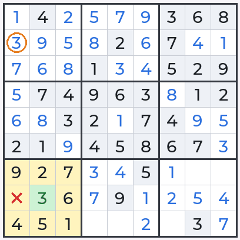

<!-- Written by tools/walkthrough.py classic: edit the script, not this page. -->
# Classic, step 37: the 3 in box 7

**Step 37 of 43** · [← Step 36](step-36.md) · [All steps](../classic.md#worked-example-the-whole-puzzle) · [Step 38 →](step-38.md)

Box 7 needs a 3. r8c1: column 1 has one (r2c1). Only **r8c2** is left: **r8c2 = 3**.

**Step 37 of 43** · [← Step 36](step-36.md) · [All steps](../classic.md#worked-example-the-whole-puzzle) · [Step 38 →](step-38.md)
