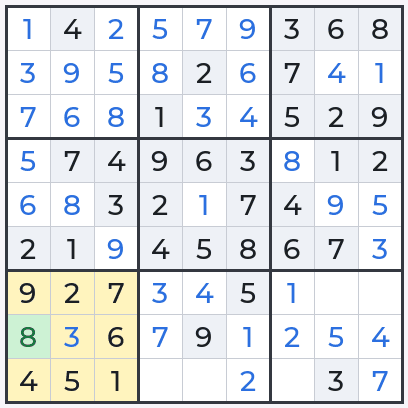

<!-- Written by tools/walkthrough.py classic: edit the script, not this page. -->
# Classic, step 38: the 8 in box 7

**Step 38 of 43** · [← Step 37](step-37.md) · [All steps](../classic.md#worked-example-the-whole-puzzle) · [Step 39 →](step-39.md)

Box 7 needs an 8, and r8c1 is its last empty cell: **r8c1 = 8**.

**Step 38 of 43** · [← Step 37](step-37.md) · [All steps](../classic.md#worked-example-the-whole-puzzle) · [Step 39 →](step-39.md)
