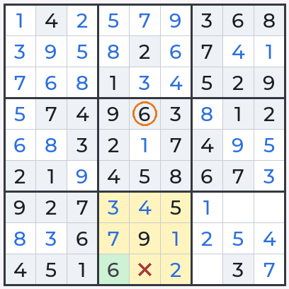

<!-- Written by tools/walkthrough.py classic: edit the script, not this page. -->
# Classic, step 39: the 6 in box 8

**Step 39 of 43** · [← Step 38](step-38.md) · [All steps](../classic.md#worked-example-the-whole-puzzle) · [Step 40 →](step-40.md)

Box 8 needs a 6. r9c5: column 5 has one (r4c5). Only **r9c4** is left: **r9c4 = 6**.

**Step 39 of 43** · [← Step 38](step-38.md) · [All steps](../classic.md#worked-example-the-whole-puzzle) · [Step 40 →](step-40.md)
