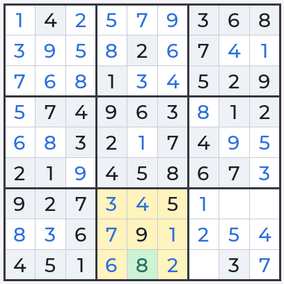

<!-- Written by tools/walkthrough.py classic: edit the script, not this page. -->
# Classic, step 40: the 8 in box 8

**Step 40 of 43** · [← Step 39](step-39.md) · [All steps](../classic.md#worked-example-the-whole-puzzle) · [Step 41 →](step-41.md)

Box 8 needs an 8, and r9c5 is its last empty cell: **r9c5 = 8**.

**Step 40 of 43** · [← Step 39](step-39.md) · [All steps](../classic.md#worked-example-the-whole-puzzle) · [Step 41 →](step-41.md)
