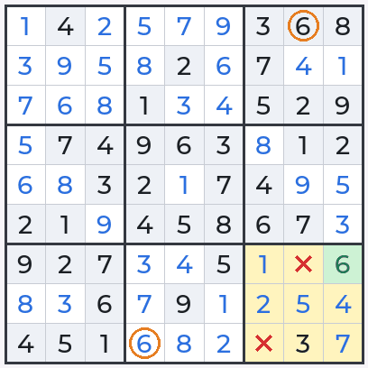

<!-- Written by tools/walkthrough.py classic: edit the script, not this page. -->
# Classic, step 41: the 6 in box 9

**Step 41 of 43** · [← Step 40](step-40.md) · [All steps](../classic.md#worked-example-the-whole-puzzle) · [Step 42 →](step-42.md)

Box 9 needs a 6. r7c8: column 8 has one (r1c8). r9c7: row 9 has one (r9c4). Only **r7c9** is left: **r7c9 = 6**.

**Step 41 of 43** · [← Step 40](step-40.md) · [All steps](../classic.md#worked-example-the-whole-puzzle) · [Step 42 →](step-42.md)
